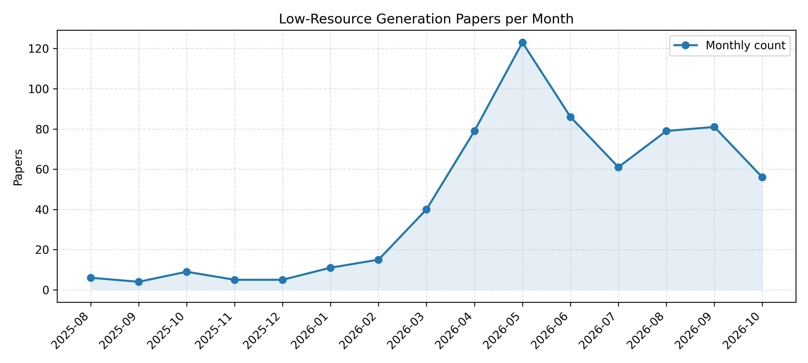

[![Contributors][contributors-shield]][contributors-url]
[![Forks][forks-shield]][forks-url]
[![Stargazers][stars-shield]][stars-url]
[![Issues][issues-shield]][issues-url]

# Low-Resource Generation Arxiv Daily Paper

This repository tracks low-resource generation related papers from arXiv.

## Updated on 2026.10.29

## Summary

- Total papers in JSON: **698**
- Recent 30 days: **104**
- Older than 30 days: **594**
- README display limit: **200** papers; extra papers stay in `docs/arxiv-daily.json`.

## Recent 30 Days

|Date|Title|Categories|PDF|Code|
|---|---|---|---|---|
|**2026-10-27**|**Aligning Large Language Models for Safety in African Languages: A Case Study of Hausa**|cs.CL, cs.AI|[2610.37245v1](http://arxiv.org/abs/2610.37245v1)|null|
|**2026-10-27**|**Text Generation in Low-Resource Languages Using Human-Curated Vocabularies**|cs.CL|[2610.37105v1](http://arxiv.org/abs/2610.37105v1)|**[code](https://github.com/michaelsinanta/vocab2text)**|
|**2026-10-27**|**The State and Fate of Multilingual, Contextual Evaluation in the NLP World**|cs.CL|[2610.36990v1](http://arxiv.org/abs/2610.36990v1)|**[code](https://aka.ms/multilingual-evals)**|
|**2026-10-27**|**Learning from Points and Patches: A Pre-trained Hybrid Attention Transformer for Time Series Analysis**|cs.LG|[2610.36572v1](http://arxiv.org/abs/2610.36572v1)|**[code](https://github.com/TangPeiwang/TimeHAT)**|
|**2026-10-26**|**EVA-Flow: Learning Shared Chemistry for Unified Environment-Aware Molecular Conformation Generation**|cs.LG, cs.CE|[2610.36280v1](http://arxiv.org/abs/2610.36280v1)|null|
|**2026-10-26**|**Ranking Function Generation with LLMs for Termination**|cs.SE, cs.AI, cs.LO|[2610.35523v1](http://arxiv.org/abs/2610.35523v1)|null|
|**2026-10-26**|**Quality over Quantity: Rethinking Data and Model Assumptions for Bengali Coreference Resolution**|cs.CL|[2610.35114v1](http://arxiv.org/abs/2610.35114v1)|null|
|**2026-10-25**|**Transformer to GPT-5: Advancements, Limitations, and Future Directions in Large Language Model Design**|cs.CL, cs.LG|[2610.34281v1](http://arxiv.org/abs/2610.34281v1)|null|
|**2026-10-24**|**The Hitchhiker's Guide to System 1 Models: Fast Decision-Making Beyond LLMS**|cs.AI, cs.CL|[2610.33775v1](http://arxiv.org/abs/2610.33775v1)|null|
|**2026-10-24**|**Beyond Prompts: A Systematic Study of LLM-Based Machine Translation Evaluators**|cs.CL|[2610.33741v1](http://arxiv.org/abs/2610.33741v1)|null|
|**2026-10-23**|**Measure Before You Train: Typed Decision Models vs. a Classical Baseline vs. a Generative LLM for Routing a Personal Multilingual Inbox**|cs.CL, cs.HC, cs.LG|[2610.32955v1](http://arxiv.org/abs/2610.32955v1)|null|
|**2026-10-23**|**Data-Efficient Backdoor Attacks on Code Models via Trigger-Neutralized Counterfactual Scoring**|cs.CR, cs.AI|[2610.32334v1](http://arxiv.org/abs/2610.32334v1)|null|
|**2026-10-22**|**Real-to-Sim Calibration of Bosch Etching Simulators with Few-Shot XSEM Data and Hybrid Search**|cs.CE, cs.LG|[2610.31904v1](http://arxiv.org/abs/2610.31904v1)|null|
|**2026-10-22**|**IndoNutriQA: An Indonesian Clinical Nutrition Question Answering Benchmark**|cs.CL|[2610.31256v1](http://arxiv.org/abs/2610.31256v1)|null|
|**2026-10-21**|**Climbing the Ladder: Automating Data Pipelines and Reproducing Baselines in Low-Resource Settings**|cs.CL|[2610.30374v1](http://arxiv.org/abs/2610.30374v1)|null|
|**2026-10-21**|**A Diagnostic Study of Faithfulness in Diffusion Language Models for Table-to-Text Generation**|cs.CL, cs.LG|[2610.29602v1](http://arxiv.org/abs/2610.29602v1)|null|
|**2026-10-20**|**How to Use Parallel Data for Multilingual Pretraining**|cs.CL, cs.AI|[2610.28838v1](http://arxiv.org/abs/2610.28838v1)|null|
|**2026-10-20**|**Large Flow Language Models**|cs.CL, cs.AI|[2610.28559v1](http://arxiv.org/abs/2610.28559v1)|null|
|**2026-10-19**|**Sample-efficient learning with Dense Associative Memories**|cs.LG|[2610.27384v1](http://arxiv.org/abs/2610.27384v1)|null|
|**2026-10-19**|**Global Security Blind Spots: Translation as a Safety Bypass in Low-Resource Languages**|cs.CL, cs.AI, cs.CR, cs.LG|[2610.27304v1](http://arxiv.org/abs/2610.27304v1)|null|
|**2026-10-19**|**ORBIT: Autoregressive Time Series Generation via Next Frequency-Band Prediction**|cs.LG|[2610.27000v1](http://arxiv.org/abs/2610.27000v1)|null|
|**2026-10-19**|**Concerns in Benchmarking Jailbreaks: An Empirical Study of Attack Success Rates**|cs.LG, cs.AI|[2610.26595v1](http://arxiv.org/abs/2610.26595v1)|null|
|**2026-10-19**|**PhyPro-FM: A Physics and Prompt-Guided Graph Foundation Model for Contingency Analysis**|eess.SY, cs.AI, cs.LG|[2610.26351v1](http://arxiv.org/abs/2610.26351v1)|null|
|**2026-10-19**|**Conditional information Retrieval for Longitudinal Survey Harmonisation**|cs.CL, cs.CY, cs.IR|[2610.26173v1](http://arxiv.org/abs/2610.26173v1)|null|
|**2026-10-19**|**DeepSEA: A Multilingual Evaluation Benchmark for Southeast Asia**|cs.CL|[2610.26155v1](http://arxiv.org/abs/2610.26155v1)|null|
|**2026-10-19**|**FinSafeGuard: A Quality-Driven Synthetic Dataset for Financial AI Safety**|cs.AI|[2610.26066v1](http://arxiv.org/abs/2610.26066v1)|null|
|**2026-10-18**|**FoundPDE: A generative foundation model for data-driven symbolic discovery of partial differential equations**|physics.comp-ph, cs.AI, cs.LG|[2610.26963v1](http://arxiv.org/abs/2610.26963v1)|null|
|**2026-10-18**|**Stepwise Reasoning Verification: Don't Generate, Classify!**|cs.AI|[2610.25441v1](http://arxiv.org/abs/2610.25441v1)|null|
|**2026-10-18**|**P2N: Reusing Deep Representations for Greater Effective Depth**|cs.CL|[2610.25076v2](http://arxiv.org/abs/2610.25076v2)|null|
|**2026-10-18**|**The World as Viewed by 136 Countries: An Open, Curated, Annotated, and Multilingual Dataset of 118 Million State Media Articles**|cs.CL, cs.CY|[2610.24990v1](http://arxiv.org/abs/2610.24990v1)|**[code](https://huggingface.co/collections/manestay/worldstatemedia)**|
|**2026-10-17**|**A Cross-Domain Evaluation of Prompting Techniques for Large Language Models**|cs.AI, cs.CL|[2610.24913v1](http://arxiv.org/abs/2610.24913v1)|null|
|**2026-10-17**|**GLOSS-MT: Controllable Low-Resource Machine Translation with an Editable Dictionary**|cs.CL, cs.AI|[2610.24730v1](http://arxiv.org/abs/2610.24730v1)|null|
|**2026-10-16**|**From Billion-Scale to Million-Scale Language Models: Operational Capabilities for Embedded Post-Exploitation**|cs.CR, cs.AI|[2610.23534v1](http://arxiv.org/abs/2610.23534v1)|null|
|**2026-10-16**|**MAS-Bai: Linguistically Informed Adaptive Multi-Agent Translation for Bowen-Script Bai**|cs.CL|[2610.23205v1](http://arxiv.org/abs/2610.23205v1)|null|
|**2026-10-16**|**Do Speech BCIs Need Larger Models? Rethinking Neural Decoding beyond Scaling**|cs.CL|[2610.23175v1](http://arxiv.org/abs/2610.23175v1)|null|
|**2026-10-16**|**Chinese Decision: A Family of Language Models for Single-Pass Probabilistic Decision-Making**|cs.CL|[2610.23170v2](http://arxiv.org/abs/2610.23170v2)|null|
|**2026-10-15**|**HeRE: A Novel Benchmark for Hebrew Relation Extraction via LLM-Guided Denoising of Knowledge Graph Alignments**|cs.CL, cs.LG|[2610.22542v1](http://arxiv.org/abs/2610.22542v1)|null|
|**2026-10-15**|**Pearl-Chat: Engineering a native Luganda language model from first principles in JAX and Flax NNX**|cs.CL|[2610.22529v1](http://arxiv.org/abs/2610.22529v1)|null|
|**2026-10-15**|**Multi-Target Few-Shot Prompting with Diffusion Language Models**|cs.CL|[2610.22294v1](http://arxiv.org/abs/2610.22294v1)|null|
|**2026-10-15**|**Unfragmenting Nawatl NMT: Single-Variant Specialization for Masewalkopa**|cs.CL|[2610.22110v1](http://arxiv.org/abs/2610.22110v1)|null|
|**2026-10-15**|**Dynamic ordering in sequence generation in Transformers: experiments on low-resource Tagging scenarios**|cs.CL|[2610.21862v1](http://arxiv.org/abs/2610.21862v1)|null|
|**2026-10-15**|**Abstracts or full text? Evaluating input scope and computational efficiency in biomedical lay summarization**|cs.CL|[2610.21690v1](http://arxiv.org/abs/2610.21690v1)|null|
|**2026-10-15**|**Translation Circuit Discovery and Targeted Optimization for Low-Resource Multilingual Translation**|cs.CL|[2610.21456v1](http://arxiv.org/abs/2610.21456v1)|null|
|**2026-10-15**|**Recursive Reward Improvement via Adversarial Meta-Prompt Evolution**|cs.AI, cs.MA|[2610.21040v1](http://arxiv.org/abs/2610.21040v1)|null|
|**2026-10-15**|**Efficient Agnostic Learning of Univariate Densities Under Local Differential Privacy**|stat.ML, cs.CR, cs.DS, cs.IT, cs.LG|[2610.21033v1](http://arxiv.org/abs/2610.21033v1)|null|
|**2026-10-14**|**CoTranslator: Reverse to Forward Chain-of-Thought Translator for Reasoning Distillation**|cs.CL, cs.AI, cs.LG|[2610.20828v1](http://arxiv.org/abs/2610.20828v1)|null|
|**2026-10-14**|**HEM-Med: A Hierarchical Agentic Memory Framework for Safe Multi-Center Medication Recommendation**|cs.AI, cs.IR|[2610.20191v2](http://arxiv.org/abs/2610.20191v2)|null|
|**2026-10-14**|**Structure-Preserving Document-Level Data Augmentation via Discourse Parsing**|cs.CL, cs.AI|[2610.19497v1](http://arxiv.org/abs/2610.19497v1)|null|
|**2026-10-13**|**PairIT: Autoregressive Transformers for Low-Data Molecule Optimization**|cs.LG, cs.AI, physics.chem-ph|[2610.19123v1](http://arxiv.org/abs/2610.19123v1)|null|
|**2026-10-13**|**Towards a Data-Centric Understanding of Spatial Reasoning in Multimodal Large Language Models**|cs.CV, cs.AI, cs.CL|[2610.19108v1](http://arxiv.org/abs/2610.19108v1)|null|
|**2026-10-13**|**Evaluating Large Language Models for Multilingual Abstractive Summarization: A Comprehensive Study of English and Bengali**|cs.CL, cs.AI|[2610.19003v1](http://arxiv.org/abs/2610.19003v1)|null|
|**2026-10-13**|**Back-Translation Still Matters: Leveraging Monolingual Data for Low-Resource Machine Translation with LLMs**|cs.CL, cs.AI|[2610.18818v3](http://arxiv.org/abs/2610.18818v3)|null|
|**2026-10-12**|**Generative Models as Adaptive Trust Regions for Discrete Bayesian Optimisation**|cs.LG|[2610.16992v1](http://arxiv.org/abs/2610.16992v1)|null|
|**2026-10-12**|**PATMT2: Two-stage domain adaptation for multilingual patent translation**|cs.CL, cs.AI|[2610.16466v1](http://arxiv.org/abs/2610.16466v1)|null|
|**2026-10-11**|**Robust Marathi Sentiment Analysis using Domain-Adaptive Pre-training and Data Augmentation Approaches**|cs.CL, cs.LG|[2610.15761v1](http://arxiv.org/abs/2610.15761v1)|null|
|**2026-10-10**|**Amharic-English Cross-Language Question Answering Using Statistical Machine Translation, Named Entity Recognition, and Semantic Indexing**|cs.CL|[2610.14756v1](http://arxiv.org/abs/2610.14756v1)|null|
|**2026-10-09**|**Structural Automata for Neural Semantic Parsing**|cs.CL|[2610.13896v1](http://arxiv.org/abs/2610.13896v1)|null|
|**2026-10-09**|**Inference-Time Steering Across Scaffolds and Epitopes for Sample-Efficient De Novo Nanobody Design**|cs.LG|[2610.13844v1](http://arxiv.org/abs/2610.13844v1)|null|
|**2026-10-09**|**OccludeBench: Can VLMs Find What's Missing?**|cs.CV, cs.CL|[2610.13790v1](http://arxiv.org/abs/2610.13790v1)|null|
|**2026-10-09**|**SharP: Soft and Hard Prompt-Guided Augmentation with LLM for Low Resource Fake News Detection**|cs.CL|[2610.13207v1](http://arxiv.org/abs/2610.13207v1)|null|
|**2026-10-09**|**CB-Orchestrator: Adaptive Workflow Optimization for LLM Agents via Contextual Bandits**|cs.LG|[2610.13064v1](http://arxiv.org/abs/2610.13064v1)|null|
|**2026-10-09**|**COFFEQA: Counterfactual-Guided Few-Shot Distillation for LLM Question Answering**|cs.CL, cs.AI, cs.LG|[2610.12837v1](http://arxiv.org/abs/2610.12837v1)|null|
|**2026-10-08**|**STAPLE: Static Sparse Upcycling of Pretrained Checkpoints via Embedding Modules**|cs.LG|[2610.12599v1](http://arxiv.org/abs/2610.12599v1)|null|
|**2026-10-08**|**Ambient Discrete Diffusion: Using the Wrong Data at the Right Time for Data Efficient Learning**|cs.LG|[2610.12340v1](http://arxiv.org/abs/2610.12340v1)|null|
|**2026-10-08**|**Zatom-2: Multitask Pretraining on Atomistic Data for Generative Modeling across Domains**|cs.LG, cs.AI|[2610.11454v2](http://arxiv.org/abs/2610.11454v2)|null|
|**2026-10-08**|**Fact over Fiction: Detection of Pathological Hallucinations in Sinhala-to-English Neural Machine Translation**|cs.CL|[2610.11389v1](http://arxiv.org/abs/2610.11389v1)|null|
|**2026-10-08**|**Sample-Efficient Generative Conformal Prediction**|cs.LG, stat.ME|[2610.11349v1](http://arxiv.org/abs/2610.11349v1)|null|
|**2026-10-08**|**Local Prototype Reconstruction for Text-Compatible Speech-to-LLM Bridge Pretraining**|cs.CL, cs.SD|[2610.11159v1](http://arxiv.org/abs/2610.11159v1)|null|
|**2026-10-07**|**Large Language Models for Machine Translation Quality Annotation: Humans and Models Are Both Challenged**|cs.CL|[2610.10918v1](http://arxiv.org/abs/2610.10918v1)|null|
|**2026-10-07**|**Document-Level Text Simplification in Estonian Using Large Language Models**|cs.CL|[2610.10378v1](http://arxiv.org/abs/2610.10378v1)|null|
|**2026-10-07**|**From Prompts to Trees: Effective LLM-Guided Tree Generation for Few-Shot Tabular Classification**|cs.LG, cs.AI, cs.CL|[2610.10227v1](http://arxiv.org/abs/2610.10227v1)|null|
|**2026-10-07**|**Quantum anomaly detection in real scarce data**|quant-ph, cs.LG|[2610.09635v1](http://arxiv.org/abs/2610.09635v1)|null|
|**2026-10-07**|**Which Language Should a Skeleton Speak? Language Choices in Multilingual Reasoning**|cs.CL, cs.AI|[2610.09607v1](http://arxiv.org/abs/2610.09607v1)|**[code](https://github.com/lhsstn/LASEF)**|
|**2026-10-07**|**Dialect-Robust Speech Language Models with Synthetic Pseudo-Dialect Augmentation**|cs.CL, eess.AS|[2610.09321v1](http://arxiv.org/abs/2610.09321v1)|null|
|**2026-10-06**|**Multi-Objective Aligned Small Language Model Framework for SUD Patient Dialogue Generation**|cs.CL, cs.AI|[2610.09209v1](http://arxiv.org/abs/2610.09209v1)|null|
|**2026-10-06**|**Language Unalignability: Why Some Concepts Resist Cross-Cultural Benchmark Evaluation**|cs.CL|[2610.08303v1](http://arxiv.org/abs/2610.08303v1)|null|
|**2026-10-06**|**VOMMI: Collecting and Leveraging Portable Demonstrations for Mobile Manipulation**|cs.RO, cs.AI|[2610.08220v1](http://arxiv.org/abs/2610.08220v1)|null|
|**2026-10-06**|**Improving Synthetic Data Generation for Argument Mining via Adversarial Reinforcement Learning**|cs.LG, cs.CL|[2610.07699v1](http://arxiv.org/abs/2610.07699v1)|null|
|**2026-10-05**|**HyperNSDE: Personalized Neural SDEs for Joint Static-Longitudinal Clinical Data Generation**|stat.ML, cs.LG, stat.AP, stat.ME|[2610.07383v1](http://arxiv.org/abs/2610.07383v1)|null|
|**2026-10-05**|**Xaurora: Generative Weather Forecasting with Denoising Stochastic Interpolants from a Foundation Model Prior**|cs.LG, physics.ao-ph|[2610.06509v1](http://arxiv.org/abs/2610.06509v1)|null|
|**2026-10-05**|**Constraint-Aware Conversational Job Recommendation in Code-Mixed Low-Resource Settings**|cs.IR|[2610.05787v1](http://arxiv.org/abs/2610.05787v1)|**[code](https://huggingface.co/datasets/Armans33115/JobCCC-Conversational-Job-Recommendation-Bangladesh)**|
|**2026-10-04**|**Investigating Model Compression for Neural Machine Translation in the Biomedical Domain**|cs.CL, cs.AI, cs.LG|[2610.07032v1](http://arxiv.org/abs/2610.07032v1)|null|
|**2026-10-04**|**Image Synthesis as an Intermediate for Controllable Time Series Generation**|cs.AI|[2610.05211v1](http://arxiv.org/abs/2610.05211v1)|null|
|**2026-10-03**|**Penumbra: Sample-Efficient Adversarial Search for Regulatory Obligations**|cs.AI, cs.CL, cs.CR|[2610.04693v3](http://arxiv.org/abs/2610.04693v3)|null|
|**2026-10-03**|**Agentic AI with Structured CoT for Enhancing AI's Spatial Intelligence: Visualization and Reasoning of Rotation**|cs.AI|[2610.04188v4](http://arxiv.org/abs/2610.04188v4)|null|
|**2026-10-02**|**Protecting Sensitive Data in Image Synthesis via PAC-Private Adaptation for Diffusion Models**|cs.LG|[2610.04038v1](http://arxiv.org/abs/2610.04038v1)|null|
|**2026-10-02**|**Multilingual GSM-Symbolic: What determines capability transfer across languages?**|cs.AI, cs.CL|[2610.03367v2](http://arxiv.org/abs/2610.03367v2)|null|
|**2026-10-02**|**Geometry Meets Physics: Data-Efficient Pre-Training for Unstructured Neural PDE Solvers**|cs.AI|[2610.03363v3](http://arxiv.org/abs/2610.03363v3)|**[code](https://github.com/tum-pbs/GMP)**|
|**2026-10-02**|**Predicting Steering Vectors and Adapter Weights for Few-Shot Author-Style Transfer**|cs.CL, cs.AI|[2610.03163v1](http://arxiv.org/abs/2610.03163v1)|null|
|**2026-10-02**|**Enhancing Biomedical Named Entity Recognition via Multiple Programming Languages Instruction Tuning and Ensemble Method**|cs.CL|[2610.02949v3](http://arxiv.org/abs/2610.02949v3)|null|
|**2026-10-01**|**Fine-Grained Emotion Classification from Mobile App Reviews: An Empirical Study with Large Language Models**|cs.CL, cs.IR, cs.SE|[2610.03802v1](http://arxiv.org/abs/2610.03802v1)|null|
|**2026-10-01**|**How To Train Your World Model: Fine-tuning vs RAG for LM-based World Modeling**|cs.AI|[2610.02542v1](http://arxiv.org/abs/2610.02542v1)|null|
|**2026-10-01**|**Social bot detection in the age of ChatGPT: Challenges and opportunities**|cs.CY, cs.CL|[2610.02386v1](http://arxiv.org/abs/2610.02386v1)|null|
|**2026-10-01**|**Precision over Scale: A Polish-Silesian Benchmark and a Translation System Outperforming Open-Source and Commercial Models**|cs.CL|[2610.01082v2](http://arxiv.org/abs/2610.01082v2)|null|
|**2026-09-30**|**On-the-fly Weight Generation: A Hypernetwork Proof of Concept on ARC-1D**|cs.LG, cs.AI|[2610.00820v1](http://arxiv.org/abs/2610.00820v1)|null|
|**2026-09-30**|**LLM-as-a-Judge for Low-Resource Languages: Adapting Ragas and Comparative Ranking for Romanian**|cs.CL|[2610.00406v1](http://arxiv.org/abs/2610.00406v1)|null|
|**2026-09-30**|**MGhana-ST: A Low-Resource Speech Translation Dataset for Ghanaian Languages and an Analysis of Multilingual Training Trade-offs**|cs.CL|[2609.40041v2](http://arxiv.org/abs/2609.40041v2)|null|
|**2026-09-30**|**AIMS: An Agentic AI Framework for Sim-to-Real Multi-Modal ISAC**|cs.AI, cs.MA|[2609.39964v2](http://arxiv.org/abs/2609.39964v2)|null|
|**2026-09-30**|**Decoupled and Distilled: Task-Adaptive LoRA-Teachers with Ensemble Knowledge Transfer for Few-Shot Class-Incremental Learning**|cs.LG|[2609.39390v1](http://arxiv.org/abs/2609.39390v1)|null|
|**2026-09-30**|**Beyond Text: LLM-Based Dimensional Emotion Evaluation in Multimodal Dialogue**|cs.CL, cs.AI, cs.LG, cs.MM|[2609.39072v1](http://arxiv.org/abs/2609.39072v1)|null|
|**2026-09-30**|**StateTree: Enhancing Long-Term Dialogue Reasoning via Reinforcement Learning**|cs.CL, cs.AI|[2609.38809v1](http://arxiv.org/abs/2609.38809v1)|null|
|**2026-09-29**|**Towards Model as a Library: Offline, Community-Sourced AI for Low-Resource African Languages**|cs.AI, cs.CL, cs.HC|[2609.38574v1](http://arxiv.org/abs/2609.38574v1)|null|
|**2026-09-29**|**MatToolBench: Benchmarking Multimodal Agents in Real-World Materials Science Workflows**|cs.AI|[2609.37053v1](http://arxiv.org/abs/2609.37053v1)|null|
|**2026-09-29**|**Dating the Model: Hidden Dates in System Prompts Affect LLM Evaluation**|cs.CL|[2609.36931v1](http://arxiv.org/abs/2609.36931v1)|null|

## Older Than 30 Days

|Date|Title|Categories|PDF|Code|
|---|---|---|---|---|
|**2026-09-28**|**The Uneven Decline of Collective Knowledge Production: Evidence from Stack Overflow After Generative AI**|cs.SE, cs.AI, cs.DL|[2609.36069v1](http://arxiv.org/abs/2609.36069v1)|null|
|**2026-09-27**|**QuPID: Quantum Parameter-Efficient Input-Dependent Retrieval Adaptation for Medical RAG**|cs.AI, cs.LG|[2609.33351v1](http://arxiv.org/abs/2609.33351v1)|null|
|**2026-09-27**|**BaatCheet: A Multilingual Corpus for Dialogue Translation in Indian Languages**|cs.CL|[2609.33296v1](http://arxiv.org/abs/2609.33296v1)|null|
|**2026-09-27**|**Save Your Saturated Data: Learning Beyond Reward Saturation in Group-Based RL**|cs.LG, cs.CL|[2609.33126v1](http://arxiv.org/abs/2609.33126v1)|null|
|**2026-09-25**|**Evaluating Cultural Awareness of LLMs for Haitian Creole**|cs.CL, cs.AI|[2609.31506v1](http://arxiv.org/abs/2609.31506v1)|null|
|**2026-09-25**|**LUMO (Lightweight Unified Multilingual Orchestrator): A Privacy Preserving Offline Voice Assistant**|cs.LG|[2609.30692v1](http://arxiv.org/abs/2609.30692v1)|null|
|**2026-09-24**|**All In Good Time: Causality-Aware Framework for LLM-Based Simultaneous Speech-to-Speech Translation**|cs.CL|[2609.30416v1](http://arxiv.org/abs/2609.30416v1)|null|
|**2026-09-23**|**Beyond Poetry: Can Large Language Models Generate Classical Arabic Maqamat?**|cs.CL, cs.AI|[2609.28245v1](http://arxiv.org/abs/2609.28245v1)|null|
|**2026-09-22**|**TransBERT: A Framework for Synthetic Translation in Domain-Specific Language Modeling**|cs.CL, cs.AI, cs.LG|[2609.26347v2](http://arxiv.org/abs/2609.26347v2)|null|
|**2026-09-22**|**ARAFA: An LLM-Generated Arabic Fact-Checking Dataset**|cs.CL, cs.IR|[2609.25833v2](http://arxiv.org/abs/2609.25833v2)|null|
|**2026-09-21**|**URA-NER: A Unified Retrieval-Augmented Framework with Retrieval Alignment and Uncertainty Reduction for Low-Resource NER**|cs.CL, cs.AI|[2609.24372v1](http://arxiv.org/abs/2609.24372v1)|null|
|**2026-09-21**|**Few-Shot Demonstrations Elicit the Use of In-Context World Representations in LLMs**|cs.AI|[2609.24352v1](http://arxiv.org/abs/2609.24352v1)|null|
|**2026-09-20**|**Error-Supervised Synthetic Learner Writing for Automated Essay Scoring**|cs.CL|[2609.23573v1](http://arxiv.org/abs/2609.23573v1)|null|
|**2026-09-20**|**BabelArena: A Large-Scale Multilingual Benchmark for LLM Agents**|cs.CL|[2609.23490v1](http://arxiv.org/abs/2609.23490v1)|null|
|**2026-09-19**|**Beyond Similarity: Coverage-Aware Prompt Selection for Time Series Forecasting with LLMs**|cs.LG, cs.CL|[2609.22977v1](http://arxiv.org/abs/2609.22977v1)|null|
|**2026-09-18**|**Hybrid Machine Learning-Assisted Raman Spectroscopy with Generative Feature Augmentation for Pharmaceutical Identification**|cs.LG, cond-mat.mtrl-sci|[2610.02224v1](http://arxiv.org/abs/2610.02224v1)|null|
|**2026-09-18**|**Not All Irregularity Is Equal: Causally Isolating a Rare Failure Mode in Japanese Morphological Inflection**|cs.CL|[2609.21179v1](http://arxiv.org/abs/2609.21179v1)|null|
|**2026-09-17**|**Generative inversion for early ranking of competing geologic interpretations**|cs.LG|[2609.20978v1](http://arxiv.org/abs/2609.20978v1)|null|
|**2026-09-17**|**SpaceDiffusion: Over-the-Orbit Diffusion for Space Generate-and-Forward Communications**|cs.IT, cs.AI|[2609.20899v1](http://arxiv.org/abs/2609.20899v1)|null|
|**2026-09-17**|**AdaRepair-Mem: Adaptive Experience Orchestration for Repository-Level Program Repair**|cs.SE, cs.AI|[2609.20130v1](http://arxiv.org/abs/2609.20130v1)|null|
|**2026-09-17**|**CliniCIRCA: A Modular LLM Framework for Constructing Longitudinal Mental Health Patient Journeys from Raw EHR Narratives**|cs.CL, cs.AI, cs.IR, cs.LG|[2609.19585v1](http://arxiv.org/abs/2609.19585v1)|null|
|**2026-09-16**|**A Scalable Framework for Automated NER Annotation Correction in Low-Resource Languages**|cs.CL, cs.AI|[2609.18739v1](http://arxiv.org/abs/2609.18739v1)|null|
|**2026-09-16**|**Machine Translation between English and Syriac (East Syriac Dialect) using Statistical Machine Learning**|cs.CL|[2609.18529v1](http://arxiv.org/abs/2609.18529v1)|null|
|**2026-09-16**|**Reinforcement Learning for Real-Time Vision-Language-Action Policies**|cs.RO, cs.LG|[2609.18207v1](http://arxiv.org/abs/2609.18207v1)|**[code](https://pd-perry.github.io/real-time-expo-ft)**|
|**2026-09-16**|**A Comprehensive Review of Generative Physical Artificial Intelligence**|cs.RO, cs.AI, cs.CL, cs.CV, cs.LG|[2609.18111v1](http://arxiv.org/abs/2609.18111v1)|null|
|**2026-09-16**|**When to Call an LLM: A Confidence-Gated Hybrid for Cost-Effective Emotion Recognition in Conversational AI**|cs.AI|[2609.17977v1](http://arxiv.org/abs/2609.17977v1)|null|
|**2026-09-15**|**Robust and Efficient AI Frameworks for Scalable Material Design and Property Prediction**|cond-mat.mtrl-sci, cs.LG|[2609.17646v1](http://arxiv.org/abs/2609.17646v1)|null|
|**2026-09-15**|**Towards Detecting AI-Assisted Responses in Online Surveys**|cs.CL, cs.CY|[2609.17317v1](http://arxiv.org/abs/2609.17317v1)|**[code](https://github.com/mike-qz-wang/ASURRE)**|
|**2026-09-15**|**MyoFlow: Anchor-Tied Rectified Flow for HD-sEMG Gesture Recognition Across Sessions and Subjects**|cs.LG|[2609.17194v2](http://arxiv.org/abs/2609.17194v2)|null|
|**2026-09-14**|**A Language-Guided Multimodal Foundation Model for Zero-Shot and Multi-Task Brain Signal Analysis**|cs.LG, cs.AI|[2609.15740v1](http://arxiv.org/abs/2609.15740v1)|null|
|**2026-09-14**|**Authorship attribution and aesthetic evaluation of AI poetry: a case study with Haiku**|cs.CL, cs.AI|[2609.15511v1](http://arxiv.org/abs/2609.15511v1)|null|
|**2026-09-14**|**ProtoGuide: Prototype-Driven Guidance for Class-Conditional Graph Generation**|cs.LG, cs.AI, physics.soc-ph|[2609.15239v1](http://arxiv.org/abs/2609.15239v1)|null|
|**2026-09-13**|**TriCalRAG: A Three-Strategy, Retrieval-Augmented Benchmark for On-Premise LLM-Based Root Cause Analysis in AIOps**|cs.DC, cs.AI, cs.CR, cs.ET, cs.LG|[2609.14762v1](http://arxiv.org/abs/2609.14762v1)|null|
|**2026-09-13**|**Corpus Characterization and Inverse Constitutional Fine-Tuning for Style-Aware Radiology Reports**|cs.CL|[2609.14226v1](http://arxiv.org/abs/2609.14226v1)|null|
|**2026-09-12**|**Conditional Quantum Flow Matching for Data-Scarce Physiological Signal Augmentation**|quant-ph, cs.LG, cs.MM|[2609.14019v1](http://arxiv.org/abs/2609.14019v1)|null|
|**2026-09-12**|**Scaling Hindi Quantum Natural Language Processing through Automatic Pregroup Supertagging**|cs.CL, quant-ph|[2609.13721v1](http://arxiv.org/abs/2609.13721v1)|null|
|**2026-09-12**|**The University of Melbourne WMT 2026 CreoleMT Submission: A Domain-Balanced Approach to Low-Resource Pacific Creole Machine Translation**|cs.CL|[2609.13615v1](http://arxiv.org/abs/2609.13615v1)|null|
|**2026-09-11**|**Breaking the Token Ceiling: Distilling Smaller, Stronger Byte Models**|cs.CL, cs.AI, cs.LG|[2609.12303v1](http://arxiv.org/abs/2609.12303v1)|null|
|**2026-09-10**|**Beyond Word Error Rate: A Switch Aware Evaluation of ASR and Audio Language Models on English Yoruba Code-Switched Speech**|cs.CL, cs.AI|[2609.11786v1](http://arxiv.org/abs/2609.11786v1)|null|
|**2026-09-10**|**Complex-Text Robustness Evaluation and Failure Diagnosis for Low-Resource Multilingual Text-to-Speech**|cs.CL, cs.SD|[2609.11545v1](http://arxiv.org/abs/2609.11545v1)|null|
|**2026-09-09**|**Multilingual in Name Only? Cultural and Linguistic Weaknesses of LLMs in Urdu**|cs.CL, cs.AI, cs.LG|[2609.10758v1](http://arxiv.org/abs/2609.10758v1)|null|
|**2026-09-09**|**Data-Efficient Language Modeling: From Frontier Advancement to Principle-Guided Model Improvement**|cs.CL, cs.AI|[2609.10702v1](http://arxiv.org/abs/2609.10702v1)|null|
|**2026-09-09**|**5-Dialects-BN: Unmasking the Impact of Transliteration on Bangla Dialectal LLMs**|cs.CL|[2609.09964v1](http://arxiv.org/abs/2609.09964v1)|null|
|**2026-09-09**|**Improving Cross-Lingual Token Representations by Adding a Pinch of SALT**|cs.CL, cs.AI|[2609.09953v1](http://arxiv.org/abs/2609.09953v1)|null|
|**2026-09-09**|**Leveraging Fine-grained Error Correction in Korean Speech Recognition for Consultation Services**|cs.CL|[2609.09889v1](http://arxiv.org/abs/2609.09889v1)|null|
|**2026-09-09**|**Exact Degeneracy Under Balanced k-Shot Sampling:Consequences for Small-Sample Discriminant Analysis on LLM Embeddings**|cs.LG|[2609.09860v1](http://arxiv.org/abs/2609.09860v1)|null|
|**2026-09-09**|**SEA-SpeechBench: A Large-Scale Multitask Benchmark for Speech Understanding Across Southeast Asia**|cs.CL|[2609.09672v1](http://arxiv.org/abs/2609.09672v1)|**[code](https://zwenyu.github.io/SEA-SpeechBench/)**|
|**2026-09-08**|**Do LLMs Make More Mistakes If They Do Not Believe the Input Data?**|cs.CL|[2609.09363v1](http://arxiv.org/abs/2609.09363v1)|null|
|**2026-09-08**|**RoboCousin: Build Your Own Simulation Playground for Robust Bimanual Robotic Manipulation**|cs.RO, cs.AI|[2609.08339v1](http://arxiv.org/abs/2609.08339v1)|null|
|**2026-09-08**|**LEBGen: An LLM-Enhanced Bayesian Network Framework for Few-Shot Travel Survey Data Generation**|cs.AI|[2609.08288v1](http://arxiv.org/abs/2609.08288v1)|null|
|**2026-09-07**|**BanglaMemeX: Advancing Cultural Metaphoric Image Interpretation in Bangla with a Multimodal Explainable Dataset**|cs.CL, cs.CV|[2609.08029v1](http://arxiv.org/abs/2609.08029v1)|null|
|**2026-09-07**|**Measuring Language Transfer in Robot Policies: Adding Greek to a Cosmos3 Vision-Language-Action Policy**|cs.RO, cs.AI|[2609.07470v1](http://arxiv.org/abs/2609.07470v1)|null|
|**2026-09-07**|**AAS-RAIL: Improving Information Extraction for Asset Administration Shells through Retrieval-Augmented In-Context Learning**|cs.AI|[2609.07334v1](http://arxiv.org/abs/2609.07334v1)|null|
|**2026-09-07**|**AI and TCAD for Inverse Design and Defect Discovery: From Simple Machine Learning to LLM**|cs.LG|[2609.07046v1](http://arxiv.org/abs/2609.07046v1)|null|
|**2026-09-05**|**SLATE: Are AI-Generated Slides Educationally Effective? A Benchmark for Language Teaching Quality and Learner Knowledge Acquisition**|cs.CL|[2609.06212v1](http://arxiv.org/abs/2609.06212v1)|null|
|**2026-09-04**|**Distill Globally, Adapt Locally: Reasoning Distillation and Product-Type Test-Time Training for Scalable Trade-Up Recommendation**|cs.LG|[2609.05363v1](http://arxiv.org/abs/2609.05363v1)|null|
|**2026-09-04**|**MedFlow: Class-Aware Multi-Scale Generation for Medical Time-Series Synthesis**|cs.AI|[2609.04804v1](http://arxiv.org/abs/2609.04804v1)|null|
|**2026-09-04**|**Choosing the Right Language Mode at Inference Time for Multilingual Reliability**|cs.CL|[2609.04653v1](http://arxiv.org/abs/2609.04653v1)|null|
|**2026-09-04**|**When Do Internal Probes Beat Reading the Answer? Miscalibrated Readouts and Behavior-Concealed Knowledge in Language Models**|cs.CL, cs.AI|[2609.04582v1](http://arxiv.org/abs/2609.04582v1)|null|
|**2026-09-03**|**Dynamic Adaptation of the LLM Context for Generating Routines with Coupled Semantics**|cs.SE, cs.AI|[2609.04570v1](http://arxiv.org/abs/2609.04570v1)|null|
|**2026-09-03**|**Translation as a Decision Space: A Multi-Agent Perspective on Low-Resource Dialect Generation**|cs.CL, cs.AI|[2609.04048v1](http://arxiv.org/abs/2609.04048v1)|null|
|**2026-09-03**|**Beyond BLEU: A Case for Redefining Sign Language Translation Benchmarks**|cs.CL, cs.AI|[2609.03734v1](http://arxiv.org/abs/2609.03734v1)|null|
|**2026-09-03**|**Building and Evaluating Fixed-Voice Thai TTS from Synthetic Speech**|cs.CL, cs.AI|[2609.03502v1](http://arxiv.org/abs/2609.03502v1)|null|
|**2026-09-02**|**Improving Health Literacy through Lay Summarization of Radiological Reports: An Evaluation of BioNER and Retrieval-Augmented Generation**|cs.CL|[2609.02396v1](http://arxiv.org/abs/2609.02396v1)|null|
|**2026-09-02**|**PolERo: Studying Political Evasion in Romanian**|cs.CL, cs.AI|[2609.02391v1](http://arxiv.org/abs/2609.02391v1)|null|
|**2026-09-02**|**Prototype-guided transfer of sparse literature knowledge for electrolyte additive discovery**|physics.chem-ph, cs.LG|[2609.02209v1](http://arxiv.org/abs/2609.02209v1)|null|
|**2026-09-01**|**Automated Event Log Generation from Unstructured Text Using Finetuned LLMs**|cs.AI|[2609.01320v1](http://arxiv.org/abs/2609.01320v1)|null|
|**2026-09-01**|**Measuring the Behavioral Fidelity of Long-Horizon Human Activity Simulations**|cs.AI|[2609.01257v1](http://arxiv.org/abs/2609.01257v1)|null|
|**2026-09-01**|**Text-guided flow matching enables sample-efficient crystal structure generation**|cond-mat.mtrl-sci, cs.AI|[2609.01076v2](http://arxiv.org/abs/2609.01076v2)|null|
|**2026-09-01**|**Inspicio: Open-Vocabulary, LLM-Based Sense Retrieval for Historical Languages**|cs.CL, cs.AI|[2609.00998v1](http://arxiv.org/abs/2609.00998v1)|null|
|**2026-09-01**|**Automated Tree Knowledge Graph Construction using Ontology Expansion and Retrieval from Vietnamese History Textbooks**|cs.AI|[2609.00763v1](http://arxiv.org/abs/2609.00763v1)|null|
|**2026-08-31**|**Enhancing Low-Resource Language Reasoning via High-Resource Language Feature Transfer**|cs.CL, cs.AI|[2608.30462v1](http://arxiv.org/abs/2608.30462v1)|null|
|**2026-08-31**|**Generative multi-domain transfer learning for fault detection in data-scarce wind turbines**|cs.LG|[2608.30323v1](http://arxiv.org/abs/2608.30323v1)|null|
|**2026-08-30**|**Confident but Wrong: A Constrained Decoding Diagnostic for Low-Resource Automatic Post-Editing**|cs.CL|[2609.29680v1](http://arxiv.org/abs/2609.29680v1)|null|
|**2026-08-30**|**Pak3H: Evaluating the Cost of Cultural Mismatch in LLM Alignment with a Human-Contextualized Urdu Benchmark**|cs.CL, cs.AI|[2608.30065v1](http://arxiv.org/abs/2608.30065v1)|null|
|**2026-08-30**|**Generative vs. Encoder Models for Multilingual NER: A Comprehensive Empirical Study on Naamapadam**|cs.CL|[2608.29959v1](http://arxiv.org/abs/2608.29959v1)|null|
|**2026-08-30**|**Improving Argument Saliency Coverage in Small LLMs for Long Legal Opinion Summarization via Sequence-Level Distillation**|cs.CL|[2608.29884v1](http://arxiv.org/abs/2608.29884v1)|null|
|**2026-08-30**|**GraM-Diff: A Unified Graph-Mamba Diffusion Framework for EEG-Based Alzheimer's Disease Data Generation and Diagnosis**|cs.LG|[2608.29755v1](http://arxiv.org/abs/2608.29755v1)|null|
|**2026-08-29**|**BIRD-History: A Benchmark for History-Driven Text-to-SQL with Fine-Grained Knowledge Annotations**|cs.AI, cs.CL|[2608.29345v1](http://arxiv.org/abs/2608.29345v1)|**[code](https://github.com/zjuidg/BIRD-History)**|
|**2026-08-29**|**Padārtha: Ontology-Grounded Fine-Grained NER Benchmark for Classical Sanskrit**|cs.CL|[2608.29324v1](http://arxiv.org/abs/2608.29324v1)|null|
|**2026-08-29**|**Anchoring Speech with Semantics: A Multimodal Adapter Mechanism for Automatic Speech Recognition in Low-Resource Languages**|cs.CL, cs.SD, eess.AS|[2608.29239v1](http://arxiv.org/abs/2608.29239v1)|null|
|**2026-08-29**|**Toward a Cross-Lingual Romanization Ecosystem for Sinitic Languages: A Paired Mandarin-Cantonese Case Study**|cs.CL|[2608.29170v2](http://arxiv.org/abs/2608.29170v2)|null|
|**2026-08-28**|**NL2AGBench: Benchmarking LLM Auto-Formalization for AlphaGeometry**|cs.CL, cs.AI|[2608.28481v1](http://arxiv.org/abs/2608.28481v1)|null|
|**2026-08-28**|**CNeo-Bench: Diagnosing Large Language Models on Chinese Neologisms**|cs.CL|[2608.28053v1](http://arxiv.org/abs/2608.28053v1)|null|
|**2026-08-27**|**pro-team at LLMs4OL 2026 Tasks Flagship and Reuse: Retrieval-Augmented Generation and Vocabulary-Constrained Filtering for Ontology Learning**|cs.AI|[2608.27101v2](http://arxiv.org/abs/2608.27101v2)|null|
|**2026-08-26**|**Benchmarking Arabic--Russian Machine Translation: A Comparison of Fine-tuned NMT and Few-shot LLMs under Rich Morphology and Low Lexical Overlap**|cs.CL|[2609.29559v1](http://arxiv.org/abs/2609.29559v1)|null|
|**2026-08-26**|**Cross-lingual Representation Learning via Centroid Intervention Fusion**|cs.CL|[2608.26357v1](http://arxiv.org/abs/2608.26357v1)|**[code](https://github.com/VRCMF/CIF.git)**|
|**2026-08-26**|**PhaseShift: Topology-Aware Data Harmonization and Model Consolidation Across Signalized Intersections**|cs.AI, cs.RO|[2608.25275v1](http://arxiv.org/abs/2608.25275v1)|null|
|**2026-08-25**|**Padamitra: Grounded Glossary Generation for Classical Sanskrit**|cs.CL|[2608.25038v2](http://arxiv.org/abs/2608.25038v2)|null|
|**2026-08-25**|**Do Recipes Have Personas? Characterizing and Generating Creator Style in Attributed Procedural Graphs**|cs.AI|[2608.24369v1](http://arxiv.org/abs/2608.24369v1)|null|
|**2026-08-25**|**PhysicsBench: A Unified Leaderboard for Generative and Predictive Models in Engineering Design and Simulation**|cs.LG, cs.CE|[2608.24056v1](http://arxiv.org/abs/2608.24056v1)|null|
|**2026-08-24**|**StrategyBench: Evaluating Explicit Strategy Induction in Large Language Models**|cs.AI|[2608.23475v1](http://arxiv.org/abs/2608.23475v1)|**[code](https://anonymous.4open.science/r/StrategyBench-D53C)**|
|**2026-08-24**|**MetaCaster: Meta-Harness-Optimized Agent for End-to-End Few-Shot Learning of Lightweight Time Series Forecasters**|cs.LG, cs.AI|[2608.23473v2](http://arxiv.org/abs/2608.23473v2)|null|
|**2026-08-24**|**The Geometry of Low-Resource Language Representations**|cs.CL|[2608.23358v1](http://arxiv.org/abs/2608.23358v1)|null|
|**2026-08-24**|**From Multimodal Observation to Interpretable Suggestions: Counterfactual Time-Expanded Relational Modeling of Surgical Teams**|cs.LG|[2608.23254v1](http://arxiv.org/abs/2608.23254v1)|null|
|**2026-08-24**|**Statistical Machine Translation Systems of English-Pnar Language Pair : Some Insights of the Emperical Study**|cs.CL, cs.AI|[2608.23120v1](http://arxiv.org/abs/2608.23120v1)|null|

README omitted **498** older paper(s). See `docs/arxiv-daily.json` for the full archive.

[contributors-shield]: https://img.shields.io/github/contributors/bansky-cl/low-resource-generation-arxiv-daily-paper.svg?style=for-the-badge
[contributors-url]: https://github.com/bansky-cl/low-resource-generation-arxiv-daily-paper/graphs/contributors
[forks-shield]: https://img.shields.io/github/forks/bansky-cl/low-resource-generation-arxiv-daily-paper.svg?style=for-the-badge
[forks-url]: https://github.com/bansky-cl/low-resource-generation-arxiv-daily-paper/network/members
[stars-shield]: https://img.shields.io/github/stars/bansky-cl/low-resource-generation-arxiv-daily-paper.svg?style=for-the-badge
[stars-url]: https://github.com/bansky-cl/low-resource-generation-arxiv-daily-paper/stargazers
[issues-shield]: https://img.shields.io/github/issues/bansky-cl/low-resource-generation-arxiv-daily-paper.svg?style=for-the-badge
[issues-url]: https://github.com/bansky-cl/low-resource-generation-arxiv-daily-paper/issues
